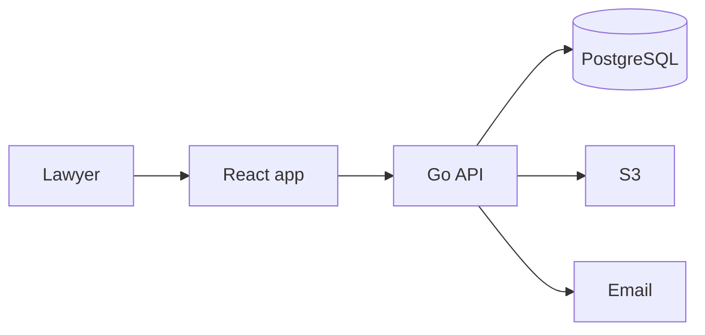

# Advocate Diary — High Level Design

## 1. Purpose

Advocate Diary is a private working file for a lawyer. They record who the client is, what the case is, which papers belong to it, when the court sits next, and get a reminder before that sitting.

Several lawyers can use the same app. Each lawyer only sees the clients, cases, files, hearings, and reminders they created. Nothing is shared between them.

There is no clerk, no shared chamber, no client portal, and no connection to a court filing system.

## 2. Users

| Actor | What they do |
| --- | --- |
| Lawyer | Signs in. Keeps their own clients, cases, papers, hearings, and reminders. |
| Client | Not a user. Exists only as a record on that lawyer's list. |

Every client, case, and file is stored under the signed-in lawyer's user id. The browser never sends that id. Another lawyer's id returns as if the record does not exist.

## 3. System context

The React app is the screens. The Go API is the only writer of PostgreSQL and S3. PostgreSQL holds lawyers, clients, cases, hearings, reminder rows, and file metadata. File bytes live in one S3 bucket, never in the database. A reminder loop inside the Go process polls due reminders and emails that lawyer only.

In production the Go server also serves the built React files, so the browser, the API, and the session cookie share one origin. During development, the React dev server proxies `/api` to Go.

A queue, a separate file service, and a mobile app are out of v1. One Go process is enough, and it keeps a hearing change and its reminder change in one database transaction.

## 4. Capabilities

| Capability | What the signed-in lawyer sees |
| --- | --- |
| Client list | Their clients: name, phone, email, address, and the cases tied to that person. |
| Case details | Court, case number, type, opposite party, status, and notes. |
| File upload | Petitions, orders, evidence, and other papers on their case. |
| Hearing dates | Date and time, court, purpose, and what happened last time. |
| Court reminders | A notice the evening before, and another two hours before the sitting, sent only to them. |
| Diary | Today and the next seven days, across their own cases. |

The diary is a read model over that lawyer's hearings. It is not a separate calendar product.

## 5. Main flows

### 5.1 Sign up

A lawyer creates an account with name, email, and password. From then on, everything they add belongs to that account. A second lawyer signing up starts from an empty diary.

### 5.2 Take on a client and open a case

The lawyer saves a client, then opens a case against that client. The case is empty of hearings until one is added. The client page lists that lawyer's cases for that person. A client with cases is not deleted; the record stays so old matters remain attributable.

### 5.3 Upload papers

The lawyer opens one of their cases and uploads a file. The Go API checks size and type, writes the bytes to S3, then writes a metadata row in PostgreSQL. The case page lists the paper. Download works only for the lawyer who owns the case: Go checks ownership, then returns a short-lived S3 link.

### 5.4 Fix a hearing and get a reminder

The lawyer adds a hearing on their case: when, which court, and why it is listed. In the same save, the app writes the hearing and two reminder rows for that lawyer. The diary shows the hearing. The reminder loop later emails them. Completing a hearing records the outcome. If the court gives a next date, that is a new hearing, not an edit of the old one.

### 5.5 Adjourn

Marking a hearing adjourned does three things together: close the old hearing, cancel its unsent reminders, and create the next hearing with a fresh pair of reminders. The old hearing stays on the case as history.

## 6. Application parts

| Part | Responsibility |
| --- | --- |
| React screens | Home, clients, case file, reminder inbox. Talk only to the Go API. |
| Go API | Session, clients, cases, documents, hearings, and the diary query. |
| Reminder loop | A goroutine in the same Go process. Every minute, claim due reminders, write an inbox row, send email to the owning lawyer, mark sent. |
| PostgreSQL | System of record for everything except file bytes. |
| S3 | One object per document, keyed by lawyer, case, and document id. |
| Email | Outbound only, to the lawyer who owns the hearing. |

The React app is not a second authority. It does not hold database credentials or S3 credentials. There is no public API for other products in v1.

## 7. How the parts share work

- The hearing module is the only writer of reminder rows. The loop only changes reminder status and writes inbox rows.
- A reminder always belongs to one hearing, and that hearing belongs to one lawyer. The loop does not fan out to anyone else.
- The case row keeps `next_hearing_at` as a copy of the earliest future scheduled hearing, so lists can sort without joining hearings every time. The hearing module updates that copy in the same transaction as the hearing change.
- File metadata points at an S3 object key. If the S3 write fails, no metadata row is kept. If the metadata insert fails, the Go API deletes the object before the error is returned.

## 8. Non-functional

| Topic | v1 choice |
| --- | --- |
| Separation | One lawyer per account. Every query filters by that user id. |
| Time | Store UTC. Show and compute "evening before" in Asia/Kolkata. |
| Files | 20 MB. PDF only. |
| Reminders | At least once, with a status transition so a retry does not double-send after success. A crash during send may send twice; the copy is the same hearing, to the same lawyer. |
| Availability | Single instance. A missed minute is recovered on the next tick because the query is "due and not yet sent". |
| Privacy | Case papers and client phones belong to one lawyer. Downloads are not public URLs that live forever. |

## 9. Out of scope

- Clerks, juniors, or a shared chamber
- Handing a case from one lawyer to another
- Client login, client uploads, or a share link
- E-filing, cause-list import, or court website scraping
- Fees, invoices, and trust accounting
- WhatsApp or SMS
- Conflict checks, limitation calculators, and template drafting

## 10. Build order

1. Lawyer sign-up and sign-in. Every later query uses the session user id.
2. Clients and cases, including the rule that a client with cases stays.
3. Diary home for a date range.
4. Hearings, adjournment, and the reminder loop.
5. Upload, list, and download on the case.

Each step is usable on its own. Reminders come after hearings exist, because a reminder always points at a hearing.
