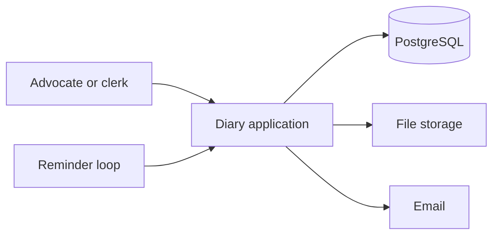

# Advocate Diary — High Level Design

## 1. Purpose

Advocate Diary is the working file for a small chamber. The advocate records who the client is, what the case is, which papers belong to it, when the court sits next, and gets a reminder before that sitting.

v1 serves one chamber. A second user can be a clerk in the same chamber. There is no client portal and no connection to a court filing system.

## 2. Users

| Actor | What they do |
| --- | --- |
| Advocate | Owns the chamber. Creates clients and cases, uploads papers, fixes hearings, reads reminders. |
| Clerk | Same chamber. Same screens. Cannot be separated from the advocate's data in v1. |
| Client | Not a user. Exists only as a record the chamber maintains. |

Every row is stored under a `chamber_id` taken from the signed-in session. The browser never chooses the chamber.

## 3. System context

The diary application is one deployable web app. It serves the screens and the API. PostgreSQL holds clients, cases, hearings, reminder rows, and file metadata. File bytes live in object storage or a disk volume, never in the database. A reminder loop inside the same deployment polls due reminders and sends in-app notices and email.

A queue, a separate file service, and a mobile app are out of v1. One process is enough for a single chamber, and it keeps hearing changes and reminder changes in one transaction.

## 4. Capabilities

| Capability | What the chamber sees |
| --- | --- |
| Client list | Name, phone, email, address, and the cases tied to that person. |
| Case details | Court, case number, type, opposite party, status, and notes. |
| File upload | Petitions, orders, evidence, and other papers on the case. |
| Hearing dates | Date and time, court, purpose, and what happened last time. |
| Court reminders | A notice the evening before, and another two hours before the sitting. |
| Diary | Today and the next seven days, across every active case. |

The diary is a read model over hearings. It is not a separate calendar product.

## 5. Main flows

### 5.1 Take on a client and open a case

The advocate saves a client, then opens a case against that client. The case is empty of hearings until one is added. The client page lists every case for that person. A client with cases is not deleted; the record stays so old matters remain attributable.

### 5.2 Upload papers

The advocate opens a case and uploads a file. The app checks size and type, writes the bytes to file storage, then writes a metadata row. The case page lists the paper. Download is allowed only for a signed-in user of that chamber.

### 5.3 Fix a hearing and remind the chamber

The advocate adds a hearing on a case: when, which court, and why it is listed. In the same save, the app writes the hearing and the reminder rows. The diary shows the hearing. The reminder loop later delivers the notices. Completing a hearing records the outcome. If the court gives a next date, that is a new hearing, not an edit of the old one.

### 5.4 Adjourn

Marking a hearing adjourned does three things together: close the old hearing, cancel its unsent reminders, and create the next hearing with a fresh pair of reminders. The old hearing stays on the case as history.

## 6. Application parts

| Part | Responsibility |
| --- | --- |
| Diary screens | Home, clients, case file, reminder inbox. |
| Session | Email and password. Cookie session. Chamber id comes from the user row. |
| Client and case module | Create and edit clients and cases. Enforce "no delete while cases exist". |
| Document module | Accept the upload, store bytes, record metadata, stream a download. |
| Hearing module | Create, complete, adjourn, and cancel hearings. Replans reminders. |
| Reminder loop | Every minute, claim due reminders, write an inbox row, send email, mark sent. |
| PostgreSQL | System of record for everything except file bytes. |
| File storage | One object per document, keyed by chamber, case, and document id. |
| Email | Outbound only, for hearing reminders. |

Screens call the application on the same host. There is no public API for other products in v1.

## 7. How the parts share work

- The hearing module is the only writer of reminder rows. The loop only changes reminder status and writes inbox rows.
- The case row keeps `next_hearing_at` as a copy of the earliest future scheduled hearing, so the client list and case list can sort without joining hearings every time. The hearing module updates that copy in the same transaction as the hearing change.
- File metadata points at storage. If the byte write fails, no metadata row is kept. If the metadata write fails, the stored object is deleted before the error is returned.

## 8. Non-functional

| Topic | v1 choice |
| --- | --- |
| Tenancy | One chamber. Schema still has `chamber_id` so a later chamber does not require a rewrite. |
| Time | Store UTC. Show and compute "evening before" in Asia/Kolkata. |
| Files | 20 MB. pdf, doc, docx, jpg, png, txt. |
| Reminders | At least once, with a status transition so a retry does not double-send after success. A crash during send may send twice; the copy is the same hearing. |
| Availability | Single instance. A missed minute is recovered on the next tick because the query is "due and not yet sent". |
| Privacy | Case papers and client phones are chamber data. Every query filters by session chamber. Downloads are not public URLs that live forever. |

## 9. Out of scope

- Client login, client uploads, or a share link
- E-filing, cause-list import, or court website scraping
- Fees, invoices, and trust accounting
- WhatsApp or SMS
- Multiple chambers in one deployment
- Conflict checks, limitation calculators, and template drafting

## 10. Build order

1. Session and chamber scope, with one seeded advocate.
2. Clients and cases, including the rule that a client with cases stays.
3. Diary home for a date range.
4. Hearings, adjournment, and the reminder loop.
5. Upload, list, and download on the case.

Each step is usable on its own. Reminders come after hearings exist, because a reminder always points at a hearing.
